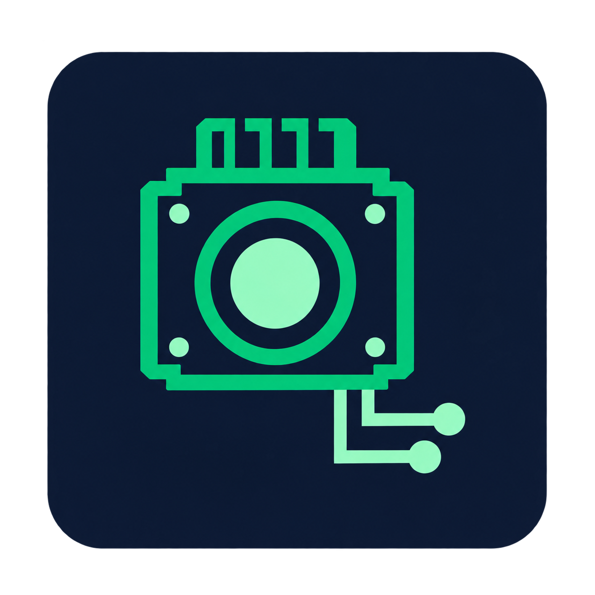

<p align="center">
  
</p>

<h1 align="center">ROS 2 GenICam Driver</h1>

<p align="center"><strong>A C++ ROS 2 driver for industrial GigE Vision and USB3 Vision cameras.</strong></p>

<p align="center">
  <a href="#quick-start">Quick start</a> ·
  <a href="#camera-configuration">Configuration</a> ·
  <a href="#device-inspection">Device inspection</a> ·
  <a href="#roadmap">Roadmap</a>
</p>

ROS 2 GenICam Driver connects industrial cameras to ROS 2 through the Aravis library. It discovers devices, configures camera features, and publishes images and camera information for downstream perception or inspection nodes. It also supports multiple streams and optional camera diagnostics.

| Transport | ROS 2 executable | Launch example |
| --- | --- | --- |
| GigE Vision | `camera_driver_gv` | [GigE Vision example](camera_aravis2/launch/camera_driver_gv_example.launch.py) |
| USB3 Vision | `camera_driver_uv` | [USB3 Vision example](camera_aravis2/launch/camera_driver_uv_example.launch.py) |

## Quick start

### Build on Ubuntu

The driver uses C++17, Aravis 0.8 or later, and ROS 2. This example uses a ROS 2 Jazzy installation and the usual `rosdep` and `colcon` workspace tools.

```bash
source /opt/ros/jazzy/setup.bash
sudo apt install libaravis-dev

mkdir -p camera_ws/src
cd camera_ws
git clone https://github.com/cpp-hardtech/ros2-genicam-driver.git src/camera_aravis2

rosdep update
rosdep install --from-paths src --ignore-src -y
colcon build --symlink-install --packages-up-to camera_aravis2
source install/setup.bash
```

On a fresh ROS installation, run `sudo rosdep init` once before `rosdep update`. Both the driver and its message package are included in the checkout.

### Discover a camera and start streaming

Run the finder with the camera attached. Copy the device identifier it reports into `CAMERA_ID`. For GigE Vision, the device IP address can also be used.

```bash
ros2 run camera_aravis2 camera_finder
```

```bash
CAMERA_ID='replace-with-device-identifier'
ros2 run camera_aravis2 camera_driver_gv --ros-args -p "guid:=$CAMERA_ID"
```

For a USB3 Vision camera, use `camera_driver_uv` in the second command. In another terminal with the workspace sourced, run `ros2 topic list` and subscribe to the image topic with your ROS 2 viewer or consumer. On Jazzy and later, a subscriber can trigger acquisition.

## Camera configuration

Use the launch file for your transport as a starting point. Set `guid` to select a specific camera and give each stream a distinct name where needed.

- **Image and acquisition.** Use `ImageFormatControl` for pixel format and the region of interest. Use `AcquisitionControl` for exposure and frame rate. Available feature names and accepted values depend on the camera model.
- **Camera information.** Use `camera_info_urls` for per-stream calibration data and `frame_id` to identify the coordinate frame in ROS 2.
- **Timing.** Enable `TransportLayerControl.PtpEnable` on supported GigE Vision cameras when the installation uses PTP. Validate timestamps against the actual camera and network configuration.
- **Runtime controls.** Use `dynamic_parameters_yaml_url` to expose selected features as changeable ROS 2 parameters. See the [dynamic parameter example](camera_aravis2/config/dynamic_parameters_example.yaml).
- **Diagnostics.** Choose the features to monitor with `diagnostic_yaml_url` and set the update rate with `diagnostic_publish_rate`. The node publishes the selected values on its private `diagnostics` topic using [CameraDiagnostics](camera_aravis2_msgs/msg/CameraDiagnostics.msg). See the [diagnostics example](camera_aravis2/config/camera_diagnostics_example.yaml).

## Device inspection

Export the GenICam XML to check the features and constraints exposed by a device. Use the same `CAMERA_ID` as above.

```bash
ros2 run camera_aravis2 camera_xml_exporter --ros-args \
  -p "guid:=$CAMERA_ID" -p "xml_file:=$PWD/camera.xml"
```

## Roadmap

The following milestones are planned for the `cpp-hardtech` edition.

- **Recover from loss of camera control.** Reopen the same device with bounded retry intervals, restore acquisition settings, and report the state of the connection throughout recovery.
- **Bound frame queues under load.** Add a configurable overflow policy and counters that distinguish transport failures from frames discarded in the driver.
- **Measure recovery and latency.** Use a simulated GigE Vision device for repeatable fault scenarios. Use compatible cameras to validate recovery after physical disconnects and measure time to the first recovered frame, dropped frames, and P95 latency.

## License

Distributed under the BSD 3-Clause License. The original copyright notice and the full
license text are retained in [LICENSE](LICENSE). Provenance and attribution
are documented in [NOTICE](NOTICE).
